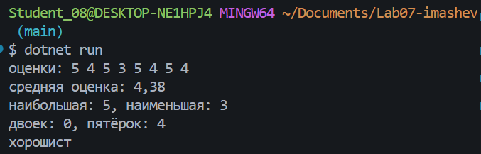
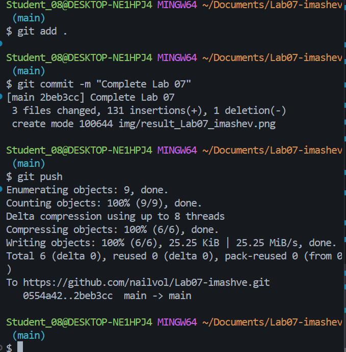

# Практическая работа №7
**ФИО:** Имашев Наиль
**Группа:** ИСП-242
**Дата:** 16.11.2026

## Что изучено
- Научился создавать массивы в C# как с готовым набором значений, так и пустыми с указанием нужного размера через new.
- Запомнил, что нумерация индексов начинается с нуля, последний индекс равен Length - 1, а выход за границы массива вызывает ошибку.
- Разобрался в разнице между циклами: foreach удобен для простого чтения всех элементов по очереди, а for нужен, когда требуется индекс или изменение самих элементов массива.

